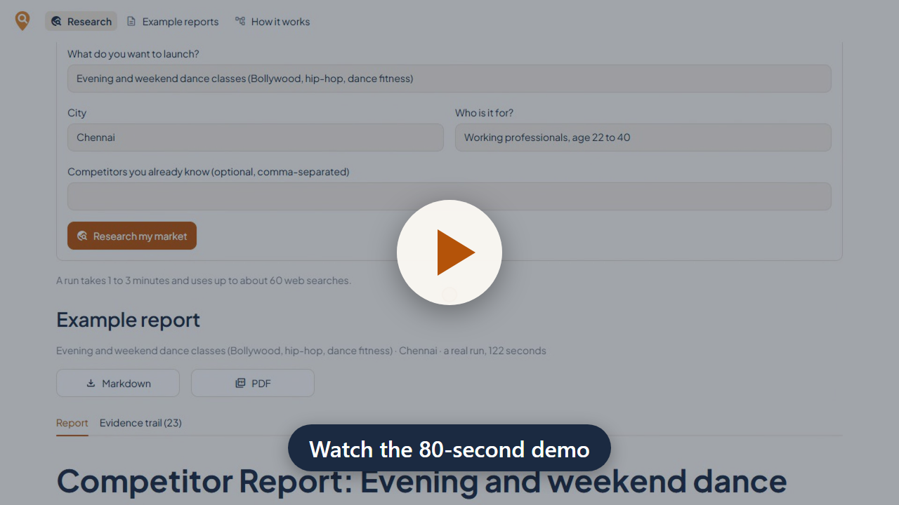
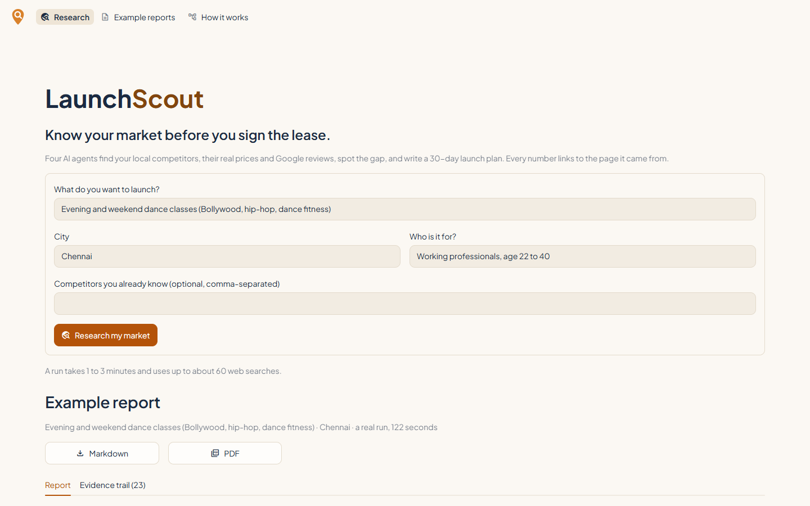
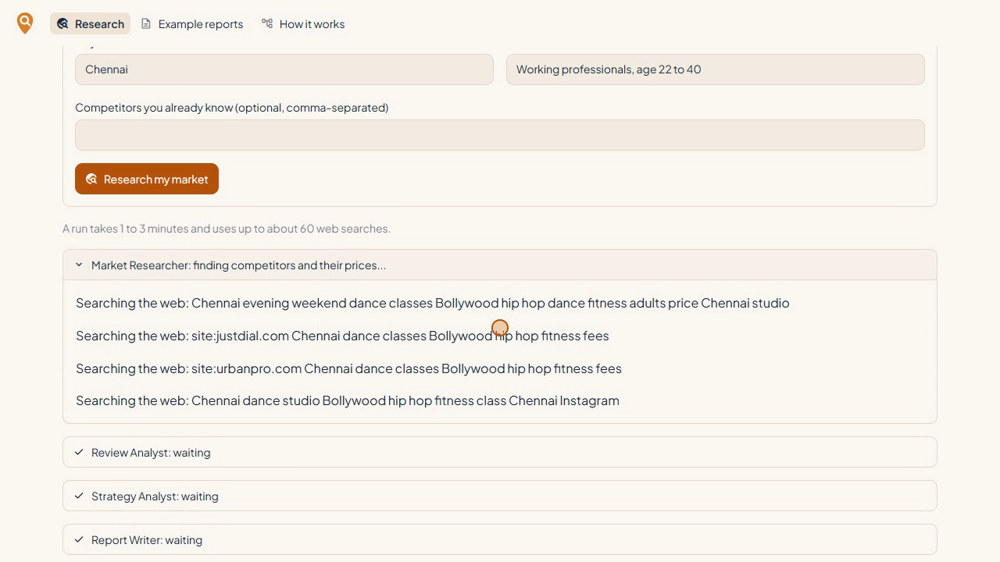
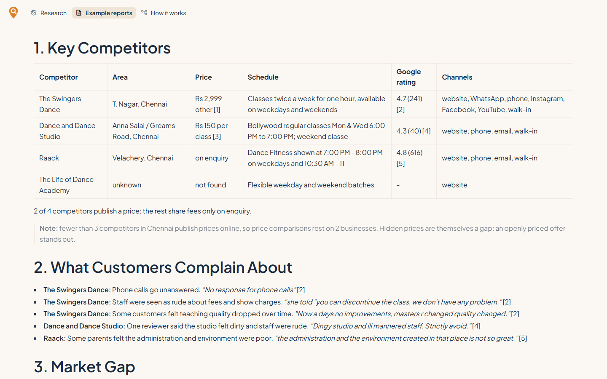
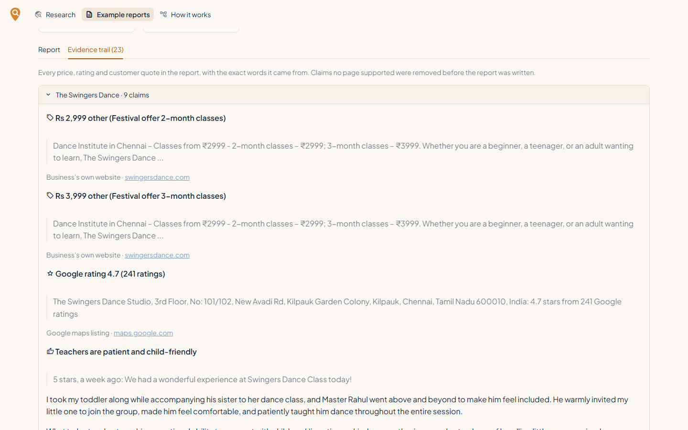
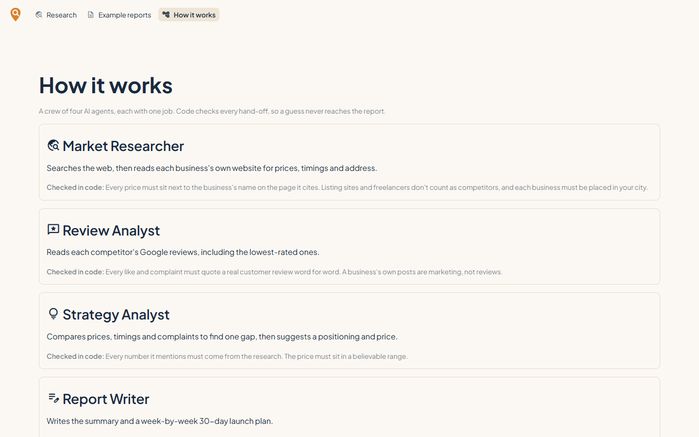
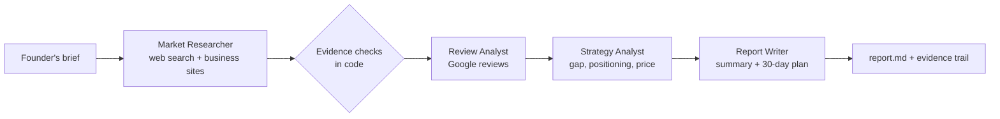

<div align="center">


# LaunchScout

**Know your market before you sign the lease.**<br>
A crew of four AI agents that researches local competitors for a new business idea: who they are,
what they charge, what their customers complain about, and where the gap is. Every number links to the page it came from.


<a href="docs/launchscout_demo.mp4"></a>

*80-second demo with voice-over and captions. Turn the sound on.*

[The problem](#the-problem) · [What it does](#what-it-does) · [Quick start](#quick-start) · [How it works](#how-it-works) · [Evaluation](#evaluation) · [Design decisions](#design-decisions) · [Limitations](#limitations-and-next-steps)

</div>

## The problem

A first-time founder wants to open, say, an after-work dance studio in Chennai or a millet lunch-box service in Coimbatore.
Before spending on a lease, they need to know: who already sells this, at what price, on which channels, and what do their
customers complain about? Today that is two or three days of searching Justdial, Instagram and Google Maps and copying into a spreadsheet,
and the numbers are hard to trust: listing sites mix city averages with real fees, and "fees on enquiry" is everywhere.

LaunchScout does that research in one to three minutes and refuses to guess: a price only reaches the report if a page shows it next to
the business's name. This is a portfolio project. The businesses in the example reports are real, and their prices and reviews are
public information the crew collected on 26 November 2026.

## What it does

| | |
|---|---|
| **Describe the idea.** Idea, city, target customer, and optionally competitors you already know. That is the whole input: the same code works for any idea and city. |  |
| **Watch the agents work.** A live log shows which agent is running and what it is doing: each web search, each business website it reads, each Google review lookup, and every time a check sends an agent back. |  |
| **Get a six-part report.** Key competitors (price, schedule, Google rating, channels), what customers complain about, the market gap, a recommended positioning and launch price, a 30-day launch plan, and numbered sources. Download it as Markdown or PDF. |  |
| **Check any claim.** The evidence trail lists every price, rating and customer quote with the exact words it came from and a link to the page. |  |
| **See how it is checked.** The How it works page explains each agent, the rule that code checks after it, and the evaluation results. |  |

## Quick start

You need Python 3.12, an [OpenAI API key](https://platform.openai.com/api-keys) and a [Serper key](https://serper.dev) (free tier: 2,500 searches).

**Windows (PowerShell)**

```powershell
git clone https://github.com/Prithvi11J/launchscout-competitor-crew.git
cd launchscout-competitor-crew
py -3.12 -m venv .venv
.venv\Scripts\python -m pip install -r requirements.txt
copy .env.example .env          # then put your keys in .env
.venv\Scripts\python scripts\check_setup.py
.venv\Scripts\streamlit run app.py
```

<details>
<summary>macOS / Linux</summary>

```bash
git clone https://github.com/Prithvi11J/launchscout-competitor-crew.git
cd launchscout-competitor-crew
python3.12 -m venv .venv
.venv/bin/python -m pip install -r requirements.txt
cp .env.example .env            # then put your keys in .env
.venv/bin/python scripts/check_setup.py
.venv/bin/streamlit run app.py
```
</details>

Run commands from the project folder. Without API keys the app still opens: research is switched off with a note, and the example
reports (with their evidence trails) are fully browsable.

### Research your own idea

| Field | Required | Example |
|---|---|---|
| What do you want to launch? | yes | Healthy millet meal boxes delivered for lunch |
| City | yes | Coimbatore |
| Who is it for? | yes | Office workers, age 25 to 40 |
| Competitors you already know | no | Comma-separated names |

Or from the command line: `.venv\Scripts\python scripts\run_crew.py --idea "..." --city "..." --customer "..."`

## How it works



The four agents run in order ([CrewAI](https://www.crewai.com/) `Process.sequential`); each task receives the checked output of the earlier
ones as `context`. After every agent, a guardrail written in Python checks its answer before the next agent sees it.

1. **Market Researcher** ([agents.py](launchscout/agents.py), [tasks.py](launchscout/tasks.py)) searches with Serper, then reads businesses' own websites.
   [evidence.py](launchscout/evidence.py) splits everything it saw into evidence units (one per search result or page) and keeps a price only if it
   appears next to the business's name with price wording around it, a source only if it names the business, and a competitor only if a page places it
   in the city. [checks.py](launchscout/checks.py) adds the rules: 3 to 6 competitors, at least 3 with a published price, no listing sites, no freelancers,
   no duplicates, and an LLM fit check that sees the founder's brief.
2. **Review Analyst** uses a Google reviews tool ([tools.py](launchscout/tools.py)): Serper's Maps endpoints, with code choosing the listing by name and
   city. [review_checks.py](launchscout/review_checks.py) keeps a like or complaint only if its quote is word for word in a real review of that business.
3. **Strategy Analyst** has no tools. [matrix.py](launchscout/matrix.py) builds the comparison table in code; [strategy_checks.py](launchscout/strategy_checks.py)
   rejects any number not in the data, competitors that were not researched, and launch prices outside a believable range.
4. **Report Writer** writes only the summary and the plan. [report.py](launchscout/report.py) assembles the report in code, and CrewAI's `output_file`
   saves it. [trail.py](launchscout/trail.py) builds the evidence trail.

When a check fails, code first repairs what it can (it moves a price to the page that really shows it, and drops what no page supports), then sends the
agent back with the exact problem and the businesses it already checked. Search budgets are enforced in the tools: at most 24 web searches, 12 page reads
and 6 review lookups per run.

## Evaluation

Web research cannot use a synthetic dataset, so the checks are tested by **planting known errors into real saved runs**:
copy a real, already-checked answer, inject one mistake of a known type, run the checks, and see whether that exact mistake is caught.

**158 of 161 planted errors caught (98%)**, 19 error types, across 6 real research runs, a review run, a strategy and a plan.

| Planted error | Caught |
|---|---|
| Price copied from another competitor | 17 / 19 |
| City-wide price range given as a competitor's price | 5 / 6 |
| Invented price on a real page · link never seen · search-engine redirect | 21 / 21 each |
| Padded source that never names the business | 16 / 16 |
| Competitor placed in the wrong city | 21 / 21 |
| Listing site as competitor · same business twice | 6 / 6 each |
| Another business's review · invented quote · marketing text as a review | 5 / 5 each |
| Wrong Google rating | 3 / 3 |
| Invented number, unknown competitor, absurd price, missing price in the strategy | 4 / 4 |
| Invented price or missing week in the launch plan | 2 / 2 |

The three misses are ambiguous rather than clear failures: two "copied" prices (Rs 1,500 and Rs 800) are common fees that may really appear next to
those studios, and one planted "city range" is printed on that studio's own page. On 9 real claims labelled by hand, the checker was right on 7.
Controls: real answers pass, and the city check keeps 21 of 23 real competitors.

The evaluation also found a real weakness: the city check used to accept the locality the agent itself claimed, and caught only **5 of 21** wrong-city
plants. It now requires the city's name on a page: **21 of 21**.

End to end, **3 of 7** real paid runs produced a full report. All four that stopped were millet lunch-box runs in Coimbatore, where few businesses
publish prices or have Google reviews; a stopped run is the checks refusing to guess, and its findings are saved for review.

Reproduce, free and offline: `.venv\Scripts\python scripts\evaluate.py` (writes [eval/results.md](eval/results.md), including every miss).

## Design decisions

- **Repair in code before asking for a retry.** Told twice to fix a wrong citation, the agent still could not. Code now moves a price to the page that
  shows it and removes unsupported claims; the agent is only sent back when what is left needs new research.
- **A source must prove the claim, not just exist.** An early run passed every "URL was seen" check while attaching a listing site's city-wide range to one
  studio. Prices now need the business's name nearby and price wording around the number, after a studio's "4000 events performed" once "proved" a copied
  Rs 4,000 fee.
- **Real reviews only.** The first review run quoted studios' own Facebook posts as customer praise. Reviews now come from Google Maps, and a quote must
  match a real review of that business word for word.
- **Budgets live in my own tools.** CrewAI's per-tool usage cap reset on every guardrail retry: one run made 15 page reads with a cap of 8. The tools now
  count usage for the whole run themselves.
- **Honest partial results.** Chennai's adult dance studios mostly do not publish fees online, and early runs passed 1 time in 3. When only two businesses
  publish prices after all retries, the report says so ("hidden prices are themselves a gap") instead of the run failing or guessing.
- **Numbers from code, words from the model.** The comparison table, quotes and sources are assembled in Python; the agents write the gap, the positioning
  and the plan, and code rejects any number in their text that is not in the data.
- **Measure, don't trust one run.** Pass rates were measured over repeated runs, and planted errors measured the checks; both changed the design.

## Command-line tools

| Command | What it does | API cost |
|---|---|---|
| `scripts\check_setup.py` | Checks the keys with one LLM call and one search | 1 search |
| `scripts\run_crew.py` | Runs all four agents; `--from` reuses saved stages | up to 54 Serper credits + LLM tokens |
| `scripts\run_research.py` | Runs only the Market Researcher | up to 24 searches |
| `scripts\replay_checks.py` | Re-runs every research check on a saved run | free |
| `scripts\evaluate.py` | Planted-error evaluation | free |

A typical full run took 74 to 142 seconds and 70k to 180k `gpt-5.4-mini` tokens.

## Tests

98 offline tests, no API keys needed: `.venv\Scripts\python -m pytest`. They cover every check, the evidence parsing, the tools' budgets and refusals,
the crew wiring, the report assembly, the PDF export and every app page (Streamlit `AppTest`, run with no keys).

## Project structure

```
app.py                 # Streamlit entry: logo, navigation
app_pages/             # Research, Example reports, How it works
ui/                    # shared state (background job, live log) and the report view
launchscout/
  agents.py tasks.py crew.py     # the four agents, their tasks, the crew
  tools.py                       # budgeted search, business page reader, Google reviews
  evidence.py checks.py          # evidence units, repair, research rules
  review_checks.py strategy_checks.py report.py   # checks for the later agents, report assembly
  matrix.py trail.py pdf.py pipeline.py progress.py
scripts/               # run, replay, evaluate, setup check
demo/                  # saved example run shown in the app
eval/                  # fixtures (real runs), labels, results
tests/                 # 98 offline tests
```

## Limitations and next steps

- Thin markets often stop: when few businesses publish prices or have Google listings, runs end with saved findings rather than a report.
- A children's fee printed in the same paragraph as an adult fee can pass the proximity check; only an honest label separates them.
- The recommended launch price varies from run to run; it is checked for range, not for one right answer.
- Search is set to Indian results (`country="in"`), and Instagram pages cannot be opened (login wall), so only their search snippets count.
- Next: a weekly re-run that highlights price changes, and a hierarchical crew with a manager agent.

## Acknowledgements

Demo voice-over and music generated with ElevenLabs.

## License

[MIT](LICENSE)
